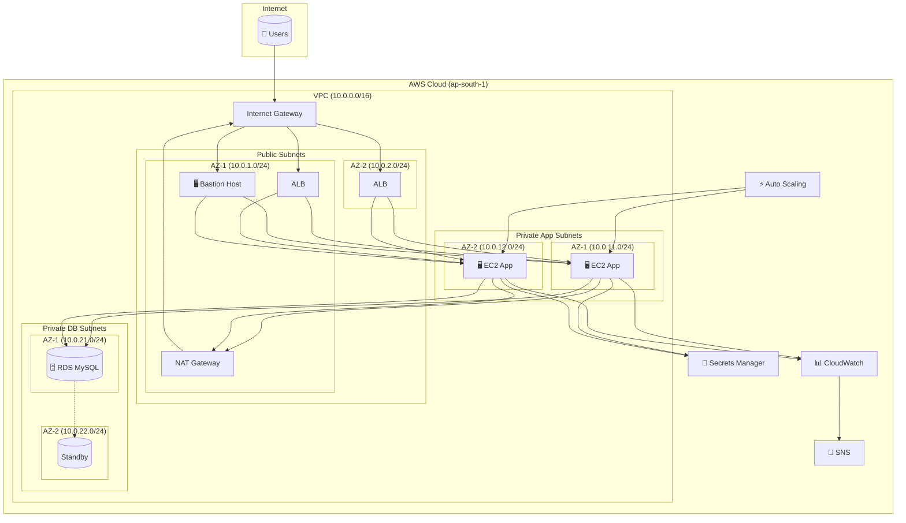

# AWS 3-Tier Infrastructure with Terraform

[](https://www.terraform.io/)
[](https://aws.amazon.com/)
[](https://github.com/Koushik926/AWS-3-Tier-Infrastructure-with-Terraform/actions)
[](LICENSE)

Production-ready, highly available 3-tier web application infrastructure on AWS, fully automated with Terraform.

## Architecture Diagram



## Features

- ✅ **High Availability**: Resources deployed across 2 Availability Zones
- ✅ **Auto Scaling**: Automatic scale-out/in based on CPU utilization
- ✅ **Self-Healing**: Unhealthy instances automatically replaced
- ✅ **Least-Privilege Security**: Security groups reference each other by ID, not CIDRs
- ✅ **Secrets Management**: Database credentials in AWS Secrets Manager
- ✅ **Monitoring & Alerting**: CloudWatch alarms with SNS email notifications
- ✅ **Remote State**: S3 backend with DynamoDB locking
- ✅ **CI/CD Ready**: GitHub Actions for validation, linting, and security scanning
- ✅ **Cost Optimized**: Free Tier eligible components where possible

## Tech Stack

| Component | Technology | Purpose |
|-----------|------------|---------|
| IaC | Terraform >= 1.6 | Infrastructure provisioning |
| Cloud | AWS | Cloud provider |
| Networking | VPC, Subnets, NAT, IGW | Network isolation |
| Load Balancing | Application Load Balancer | Traffic distribution |
| Compute | EC2 (t3.micro), ASG | Application hosting |
| Database | RDS MySQL 8.0 | Data persistence |
| Secrets | AWS Secrets Manager | Credential management |
| Monitoring | CloudWatch, SNS | Observability & alerts |
| CI/CD | GitHub Actions | Automated validation |

## Security Design

| Security Group | Inbound Rules | Outbound Rules | Purpose |
|----------------|---------------|----------------|---------|
| `alb_sg` | 80, 443 from 0.0.0.0/0 | App port to `app_sg` | Internet-facing load balancer |
| `bastion_sg` | 22 from your IP only | 22 to `app_sg`, 443 to internet | Secure SSH access |
| `app_sg` | 80 from `alb_sg`, 22 from `bastion_sg` | 443 to internet, 3306 to `db_sg` | Application tier |
| `db_sg` | 3306 from `app_sg` only | None | Database isolation |

## Prerequisites

- AWS Account (Free Tier eligible)
- AWS CLI configured (`aws configure`)
- Terraform >= 1.6.0
- EC2 Key Pair (create in AWS Console)
- Your public IP (run: `curl -s https://checkip.amazonaws.com`)

## Quick Start

### 1. Bootstrap the State Backend (One-Time)

```bash
cd bootstrap
terraform init
terraform apply
# Note the outputs: bucket name, table name
```

### 2. Configure Variables

```bash
cd environments/dev
cp terraform.tfvars.example terraform.tfvars
```

Edit `terraform.tfvars`:
```hcl
my_ip_cidr    = "YOUR_PUBLIC_IP/32"    # e.g., "203.0.113.50/32"
key_pair_name = "your-key-pair-name"
alert_email   = "your-email@example.com"
```

### 3. Initialize and Deploy

```bash
# Initialize with backend config
terraform init \
  -backend-config="bucket=<bucket-from-step-1>" \
  -backend-config="dynamodb_table=<table-from-step-1>" \
  -backend-config="region=ap-south-1"

# Review the plan
terraform plan

# Deploy
terraform apply
```

### 4. Access the Application

After deployment, Terraform outputs the ALB URL:
```bash
terraform output alb_url
# Open this URL in your browser
```

## Verifying Each Tier

### Web Tier (ALB)

```bash
# Get the ALB URL
ALB_URL=$(terraform output -raw alb_url)

# Test load balancing - refresh multiple times to see different instances
curl $ALB_URL
curl $ALB_URL
curl $ALB_URL

# Health check endpoint
curl $ALB_URL/health
```

### App Tier (EC2)

```bash
# SSH to bastion
ssh -A -i ~/.ssh/your-key.pem ec2-user@$(terraform output -raw bastion_public_ip)

# From bastion, SSH to private instance (get IP from ALB test)
ssh ec2-user@<private-instance-ip>

# Or use SSM Session Manager
aws ssm start-session --target <instance-id>
```

### Database Tier (RDS)

```bash
# Test database connectivity via the app
curl $ALB_URL/db

# From app instance, connect directly
SECRET=$(aws secretsmanager get-secret-value --secret-id $(terraform output -raw db_secret_arn) --query SecretString --output text)
mysql -h $(echo $SECRET | jq -r '.host') -u $(echo $SECRET | jq -r '.username') -p$(echo $SECRET | jq -r '.password') appdb
```

## Self-Healing & Scaling Tests

### Test 1: Instance Termination (Self-Healing)

```bash
# Get an instance ID
INSTANCE_ID=$(aws autoscaling describe-auto-scaling-groups \
  --auto-scaling-group-names $(terraform output -raw asg_name) \
  --query 'AutoScalingGroups[0].Instances[0].InstanceId' --output text)

# Terminate it
aws ec2 terminate-instances --instance-ids $INSTANCE_ID

# Watch ASG replace it (takes ~3-5 minutes)
watch aws autoscaling describe-auto-scaling-groups \
  --auto-scaling-group-names $(terraform output -raw asg_name) \
  --query 'AutoScalingGroups[0].Instances[*].[InstanceId,LifecycleState,HealthStatus]'
```

### Test 2: CPU Stress (Scale-Out)

```bash
# SSH to an instance via bastion and run stress test
stress-ng --cpu 2 --timeout 600

# Monitor in another terminal
watch "aws cloudwatch get-metric-statistics \
  --namespace AWS/EC2 \
  --metric-name CPUUtilization \
  --dimensions Name=AutoScalingGroupName,Value=$(terraform output -raw asg_name) \
  --start-time \$(date -u -v-10M '+%Y-%m-%dT%H:%M:%SZ') \
  --end-time \$(date -u '+%Y-%m-%dT%H:%M:%SZ') \
  --period 60 --statistics Average"

# Check your email for the alarm notification!
```

## Cost Estimate

| Resource | Monthly Cost (ap-south-1) |
|----------|---------------------------|
| EC2 (2× t3.micro) | Free Tier / ~$8.50 |
| RDS (db.t3.micro) | Free Tier / ~$12 |
| ALB | ~$16 |
| NAT Gateway | ~$32 + data |
| Secrets Manager | ~$0.40 |
| CloudWatch | ~$1 |
| **Total** | **~$70/month** |

> ⚠️ **IMPORTANT**: NAT Gateway costs ~$0.045/hour (~$32/month). **Run `terraform destroy` after testing to avoid charges!**

## Clean Up

```bash
# Destroy main infrastructure
cd environments/dev
terraform destroy

# Destroy bootstrap resources (S3, DynamoDB)
cd ../bootstrap
terraform destroy
```

## Project Structure

```
AWS-3-Tier-Infrastructure-with-Terraform/
├── README.md
├── .gitignore
├── .github/workflows/terraform-ci.yml
├── Makefile
├── docs/
│   ├── architecture.md
│   ├── testing-and-results.md
│   └── screenshots/.gitkeep
├── bootstrap/
│   ├── main.tf
│   ├── variables.tf
│   └── outputs.tf
├── environments/
│   └── dev/
│       ├── main.tf
│       ├── variables.tf
│       ├── outputs.tf
│       ├── providers.tf
│       ├── versions.tf
│       ├── backend.tf
│       └── terraform.tfvars.example
├── modules/
│   ├── vpc/
│   ├── security/
│   ├── bastion/
│   ├── alb/
│   ├── compute/
│   ├── database/
│   └── monitoring/
└── scripts/
    └── user_data.sh.tpl
```

## What I Learned / Design Decisions

### Why Private Subnets for App Tier?
Application servers don't need direct internet access. Placing them in private subnets with NAT Gateway provides outbound access for updates while preventing direct inbound attacks.

### Why Both Bastion AND SSM?
- **Bastion**: Traditional, works with standard SSH tools, supports agent forwarding
- **SSM**: No SSH keys needed, full audit trail, works even if bastion is down
- Having both provides flexibility and redundancy

### Why Doesn't /health Check the Database?
The `/health` endpoint must be reliable for the ALB health check. If it depended on the database, a brief DB hiccup would mark all instances unhealthy, causing cascading failures. Keep health checks simple.

### Why Secrets Manager?
Never store credentials in code or environment variables. Secrets Manager provides:
- Encrypted storage
- Automatic rotation capability
- IAM-based access control
- Audit logging

### Single NAT vs Multi-NAT Trade-off
- **Single NAT** (default): ~$32/month, all AZs share one NAT
- **Multi-NAT**: ~$64/month, each AZ has its own NAT
- For dev/test, single NAT is sufficient. For production, use multi-NAT for HA.

### Why Target Tracking Scaling?
Simpler than step scaling, automatically handles both scale-out and scale-in. Set a CPU target (50%), and ASG maintains that level automatically.

## Screenshots

> Add your screenshots to `docs/screenshots/` after deployment:

1. `terraform-apply-success.png` - Terraform apply output
2. `web-page-az1.png` - Application page showing AZ-1 instance
3. `web-page-az2.png` - Application page showing AZ-2 instance
4. `db-route.png` - /db endpoint showing visit count
5. `vpc-resource-map.png` - VPC with subnets in AWS Console
6. `target-group-healthy.png` - ALB target group with healthy targets
7. `asg-activity.png` - ASG activity showing instance replacement
8. `cloudwatch-alarm.png` - CloudWatch alarm in ALARM state
9. `sns-email.png` - SNS notification email
10. `cloudwatch-dashboard.png` - CloudWatch dashboard
11. `security-groups.png` - Security group inbound rules
12. `github-ci-passing.png` - GitHub Actions CI passing

## Author

**R Koushik**

---

*This project demonstrates AWS infrastructure skills including VPC design, auto scaling, security best practices, and Infrastructure as Code with Terraform.*
